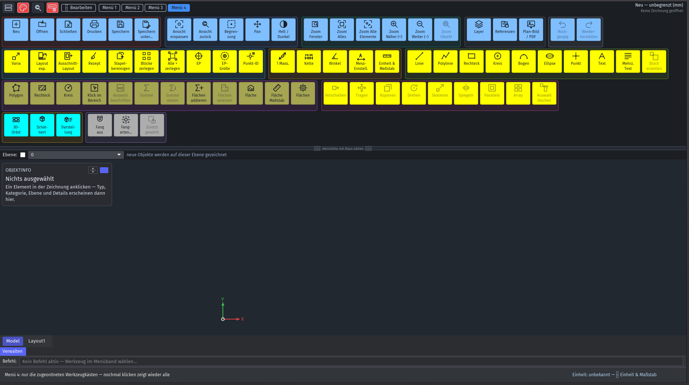
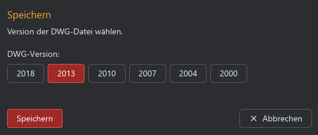
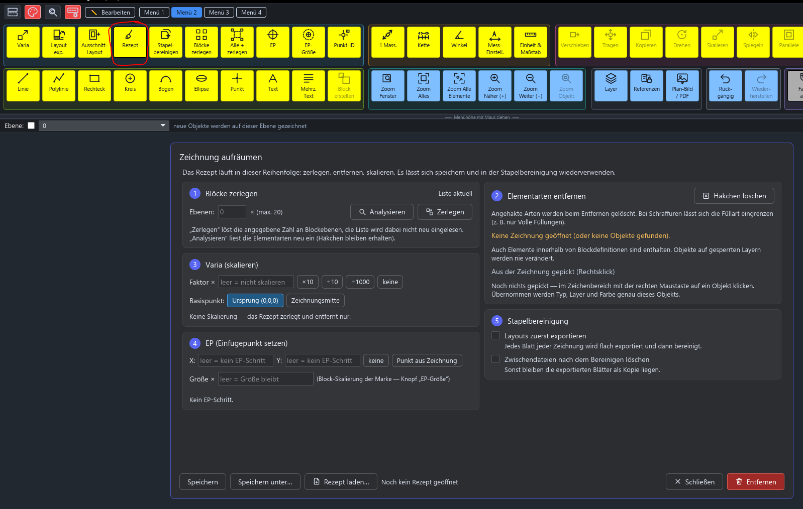
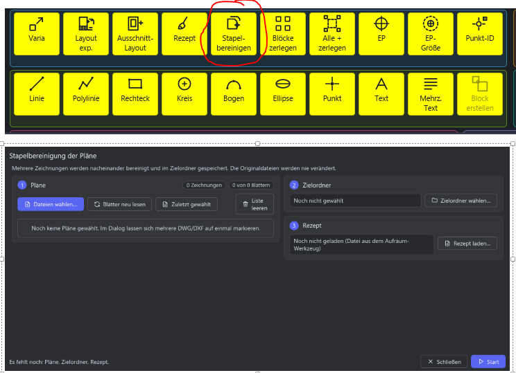

> [!IMPORTANT]
> **Attribution - this is a modified version.**
> This repository (**Kincad**) was **not written from scratch by its owner**.
> It is based on [Open CAD Studio](https://github.com/HakanSeven12/OpenCADStudio)
> by **HakanSeven12** and its contributors, which was used as the **starting base**.
> Numerous changes and improvements were then made on top of that base.
>
> - **Original project:** <https://github.com/HakanSeven12/OpenCADStudio>
> - **License:** GNU GPL v3.0. This modified version remains licensed under GPL-3.0 (see [LICENSE](LICENSE)).
> - **Modifications:** made from 2026-11-15 onward.
> - This project is **not affiliated with, sponsored by, or endorsed by** the original author.

### Changes relative to the original

This fork (**Kincad**) was derived from Open CAD Studio and then reworked. Main differences:

- **Renamed project**: crate name `KINCAD`, binary `dwgviewer` (originally `OpenCADStudio`).
- **Viewer-centric architecture**: new `src/viewer/*` modules for measuring, grips, ribbon UI, drawing tools, printing, in-place text editing, XRef attach, bounds/origin overlays, and viewport handling.
- **New feature modules**: `area_layout`, `batch`, `cleanup`, `purge`, `scale`, `layout_export`, `layout_fuse`, `picture_attach`, `qselect`, `units`, DWG probe, and ACIS outline conversion.
- **Web build reworked**: Trunk/WASM web app under `webapp/` (replacing the previous `web-app.html`).
- **New integration tests**: layout round-trip, DWG version matrix, print mapping, explode preservation, OSNAP aperture, and more.
- **Simplified build**: dropped the Cargo workspace plus the plugin-API and DWG-thumbnailer crates, and trimmed the dependency set (e.g. `iced_aw`, `iced_runtime`/`iced_core`, `clap`, `semver`, `base64`, `resvg`, `ashpd`).

The project as a whole is distributed under GPL-3.0; see [LICENSE](LICENSE).

---

<p align="center">
  <a href="README.md">English</a> ·
  <a href="docs/readme/README.bg.md">Български</a> ·
  <a href="docs/readme/README.pt-BR.md">Português (Brasil)</a> ·
  <a href="docs/readme/README.cs.md">Čeština</a> ·
  <a href="docs/readme/README.nl.md">Nederlands</a> ·
  <a href="docs/readme/README.fr.md">Français</a> ·
  <a href="docs/readme/README.fi.md">Suomi</a> ·
  <a href="docs/readme/README.de.md">Deutsch</a> ·
  <a href="docs/readme/README.el.md">Ελληνικά</a> ·
  <a href="docs/readme/README.hu.md">Magyar</a> ·
  <a href="docs/readme/README.it.md">Italiano</a> ·
  <a href="docs/readme/README.ja.md">日本語</a> ·
  <a href="docs/readme/README.ko.md">한국어</a> ·
  <a href="docs/readme/README.pl.md">Polski</a> ·
  <a href="docs/readme/README.ru.md">Русский</a> ·
  <a href="docs/readme/README.zh-CN.md">简体中文</a> ·
  <a href="docs/readme/README.es.md">Español</a> ·
  <a href="docs/readme/README.zh-TW.md">繁體中文</a> ·
  <a href="docs/readme/README.tr.md">Türkçe</a> ·
  <a href="docs/readme/README.hi.md">हिन्दी</a> ·
  <a href="docs/readme/README.ar.md">العربية</a>
</p>

<p align="center">
  
</p>

<h1 align="center">Open CAD Studio</h1>

<p align="center">
  Open-source 2D drafting and 3D modeling for desktop and web, built with Rust.
</p>

<p align="center">
  <a href="https://github.com/HakanSeven12/OpenCADStudio/releases/latest"></a>
  <a href="https://github.com/HakanSeven12/OpenCADStudio/releases"></a>
  <a href="https://github.com/HakanSeven12/OpenCADStudio/stargazers"></a>
  <a href="LICENSE"></a>
</p>

<p align="center">
  <a href="https://www.opencadstudio.com"><strong>Launch the web app</strong></a>
  ·
  <a href="https://github.com/HakanSeven12/OpenCADStudio/releases/latest"><strong>Download the desktop app</strong></a>
  ·
  <a href="https://github.com/HakanSeven12/OpenCADStudio/discussions"><strong>Join the discussion</strong></a>
</p>

<p align="center">
  
</p>

## Overview

Open CAD Studio is a cross-platform application for technical drawing, layout work, and solid modeling. It reads and writes DWG and DXF drawings natively, with a shared editing core across the desktop and browser versions.

The project is under active development. Keep backups of important production drawings and report reproducible problems through [GitHub Issues](https://github.com/HakanSeven12/OpenCADStudio/issues).

## Highlights

- **Native drawing workflow** — open, edit, recover, and save DWG and DXF files without a conversion service.
- **Precise 2D drafting** — lines, polylines, curves, splines, hatches, object snaps, tracking, layers, blocks, and external references.
- **Documentation tools** — text, dimensions, leaders, tolerances, tables, model space, paper space, viewports, and plot styles.
- **Kernel-backed 3D modeling** — solid primitives, extrusion, revolution, sweep, loft, Boolean operations, and ACIS entity tessellation.
- **GPU rendering** — accelerated 2D and 3D viewports through `wgpu`, with orthographic and perspective cameras.
- **Extensible workflows** — native plugins, command scripts, headless conversion, and a line-based JSON automation API.

<p align="center">
  
</p>

## DWG-Formate &amp; Konverter

Hier bieten wir die Kompatibilität mit verschiedenen DWG-Formaten. Im Programm ist ein Konverter integriert, der die Zeichnungen gemäß eines Rezepts von unerwünschten Bestandteilen bereinigt. Dies ist in den Bildern zwei und drei deutlich zu erkennen. Die Zeichnung lässt sich skalieren und mit einem Einfügepunkt versehen. Dies geschieht in einem Stapel, das heißt, mehrere Zeichnungen können nach einem Rezept bearbeitet werden. Danach werden sie automatisch gespeichert.

<p align="center">
  
</p>

<p align="center">
  
</p>

<p align="center">
  
</p>

## File workflows

| Format or workflow | Support |
| --- | --- |
| DWG | Read and write; versioned save targets from R14 through 2018 |
| DXF | Read and write; versioned save targets from R14 through 2018 |
| BAK / SV$ | Open drawing backups and autosave files |
| OBJ | Import polygon meshes |
| LandXML | Import `CgPoint` survey points |
| STL | Export 3D mesh data |
| STEP AP203 | Export 3D mesh data |
| PDF | Plot layouts and selected geometry on desktop |
| CSV | Extract entity property data |
| CTB / STB | Load and edit plot style tables |

## Desktop or web

Use the [web app](https://www.opencadstudio.com) for immediate access with no installation. Drawings are selected through the browser and saved as local downloads.

Use the desktop application for native file associations, file-manager thumbnails, system printing, PDF output, external plugins, command scripts, and headless automation. Release builds are available for Windows, Linux, and Apple Silicon macOS.

## Install

Download all current packages from the [latest release](https://github.com/HakanSeven12/OpenCADStudio/releases/latest).

### Windows

Choose one of these signed x86-64 packages:

- `OpenCADStudio-*-windows-x86_64-installer.msi` — recommended installer with Start Menu shortcuts, DWG/DXF file associations, and drawing thumbnails.
- `OpenCADStudio-*-windows-x86_64-portable.exe` — standalone application; no installation required.

### Linux

Download the x86-64 AppImage, make it executable, and run it:

```bash
chmod +x OpenCADStudio-*-linux-x86_64.AppImage
./OpenCADStudio-*-linux-x86_64.AppImage
```

### macOS

The published macOS package supports Apple Silicon:

1. Download `OpenCADStudio-*-macos-arm64.dmg`.
2. Open the image and drag `OpenCADStudio.app` into **Applications**.
3. If Gatekeeper blocks the first launch, approve the app from **System Settings → Privacy & Security**.

The application is ad-hoc signed but is not currently notarized by Apple.

## Languages

Open CAD Studio can follow the system language or use any of these 21 interface languages:

> Arabic · Brazilian Portuguese · Bulgarian · Czech · Dutch · English · Finnish · French · German · Greek · Hindi · Hungarian · Italian · Japanese · Korean · Polish · Russian · Simplified Chinese · Spanish · Traditional Chinese · Turkish

Change the language from the application settings. The browser version also uses the browser's preferred locale when **System** is selected.

## Build from source

### Desktop

Requirements:

- Git
- Current stable Rust toolchain
- Platform graphics and font development libraries

On Ubuntu or Debian, install the native dependencies with:

```bash
sudo apt update
sudo apt install libgl1-mesa-dev libx11-dev libxcursor-dev libxi-dev \
  libxrandr-dev libxkbcommon-dev libwayland-dev libfontconfig1-dev \
  libfreetype6-dev
```

Then build and run:

```bash
git clone https://github.com/HakanSeven12/OpenCADStudio.git
cd OpenCADStudio
cargo build --release --bin OpenCADStudio
```

The resulting binary is written to `target/release/OpenCADStudio` (`OpenCADStudio.exe` on Windows).

### Web

Install the WebAssembly target and build tools once:

```bash
rustup target add wasm32-unknown-unknown
cargo install trunk wasm-bindgen-cli
```

Start the development server:

```bash
trunk serve
```

## Automation

The desktop binary supports one-shot conversion, a persistent headless server, and a client-neutral MCP endpoint for AI applications:

```bash
OpenCADStudio --export input.dwg output.dxf
OpenCADStudio --serve
OpenCADStudio --serve --port 4242
OpenCADStudio --mcp
```

The automation server exchanges one JSON object per line over standard input/output or a local TCP socket. The self-contained MCP endpoint exposes the live desktop editor through the same tools to every compatible client. To connect a client, configure it to launch `OpenCADStudio --mcp`. See the [MCP control guide](docs/automation/README.md).

## Plugins

Desktop plugins run in separate processes and communicate with the host through the versioned plugin API. The browser build does not load native plugins.

- [Plugin architecture](docs/plugin-architecture.md)
- [Plugin template](docs/plugin-template/README.md)
- [Plugin registry](plugins/README.md)

## Project documentation

- [Automation API](docs/automation/README.md)
- [Plugin architecture](docs/plugin-architecture.md)
- [Tessellation pipeline](docs/tessellation.md)
- [Security policy](SECURITY.md)

## Contributing

Bug reports, focused pull requests, translations, documentation improvements, and plugin contributions are welcome.

- Search existing [issues](https://github.com/HakanSeven12/OpenCADStudio/issues) before opening a new report.
- Use [Discussions](https://github.com/HakanSeven12/OpenCADStudio/discussions) for questions and ideas.
- Report vulnerabilities privately by following the [security policy](SECURITY.md).

Application translations live in `locales/*/opencadstudio.ftl`; source labels map through
`src/locale_catalog.rs`. After editing translations, run `python3 scripts/export-locales.py`
to refresh web and desktop packaging labels. Validate with `python3 scripts/test_site.py`
and `cargo test --lib i18n::tests`.

## License

Open CAD Studio is distributed under the [GNU General Public License v3.0](LICENSE).
