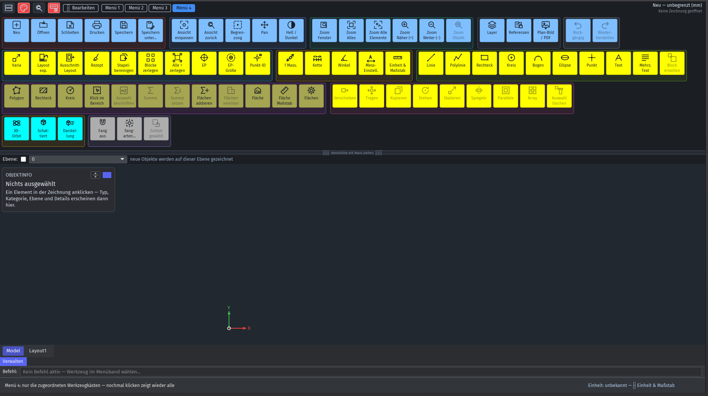

<p align="center">
  <a href="../../README.md">English</a> · <a href="README.bg.md">Български</a> · <a href="README.pt-BR.md">Português (Brasil)</a> · <a href="README.cs.md">Čeština</a> · <a href="README.nl.md">Nederlands</a> · <a href="README.fr.md">Français</a> · <a href="README.fi.md">Suomi</a> · <a href="README.de.md">Deutsch</a> · <a href="README.el.md">Ελληνικά</a> · <a href="README.hu.md">Magyar</a> · <a href="README.it.md">Italiano</a> · <a href="README.ja.md">日本語</a> · <a href="README.ko.md">한국어</a> · <a href="README.pl.md">Polski</a> · <a href="README.ru.md">Русский</a> · <a href="README.zh-CN.md">简体中文</a> · <a href="README.es.md">Español</a> · <a href="README.zh-TW.md">繁體中文</a> · <a href="README.tr.md">Türkçe</a> · <a href="README.hi.md">हिन्दी</a> · <a href="README.ar.md">العربية</a>
</p>

<p align="center"></p>

<h1 align="center">Open CAD Studio</h1>

<p align="center">Приложение с отворен код за 2D чертане и 3D моделиране за настолни системи и уеб, разработено с Rust.</p>

<p align="center">
  <a href="https://github.com/HakanSeven12/OpenCADStudio/releases/latest"></a>
  <a href="https://github.com/HakanSeven12/OpenCADStudio/releases"></a>
  <a href="https://github.com/HakanSeven12/OpenCADStudio/stargazers"></a>
  <a href="../../LICENSE"></a>
</p>

<p align="center">
  <a href="https://www.opencadstudio.com"><strong>Отворете уеб приложението</strong></a> ·
  <a href="https://github.com/HakanSeven12/OpenCADStudio/releases/latest"><strong>Изтеглете настолното приложение</strong></a> ·
  <a href="https://github.com/HakanSeven12/OpenCADStudio/discussions"><strong>Присъединете се към дискусията</strong></a>
</p>

## Общ преглед

Open CAD Studio е междуплатформено приложение за техническо чертане, работа с оформления и моделиране на твърди тела. То чете и записва DWG и DXF чертежи директно, като настолната и браузърната версия използват общо ядро за редактиране.

Проектът се разработва активно. Пазете резервни копия на важните производствени чертежи и съобщавайте възпроизводими проблеми чрез [GitHub Issues](https://github.com/HakanSeven12/OpenCADStudio/issues).

<p align="center"></p>

## Инсталиране

Изтеглете всички актуални пакети от [последната версия](https://github.com/HakanSeven12/OpenCADStudio/releases/latest).

### Windows

Изберете един от подписаните x86-64 пакети:

- `OpenCADStudio-*-windows-x86_64-installer.msi` — препоръчителна инсталационна програма с преки пътища в менюто Start, файлови асоциации за DWG/DXF и миниатюри на чертежите.
- `OpenCADStudio-*-windows-x86_64-portable.exe` — самостоятелно приложение без необходимост от инсталиране.

### Linux

Изтеглете x86-64 AppImage файла, направете го изпълним и го стартирайте:

```bash
chmod +x OpenCADStudio-*-linux-x86_64.AppImage
./OpenCADStudio-*-linux-x86_64.AppImage
```

### macOS

Публикуваният пакет за macOS поддържа Apple Silicon:

1. Изтеглете `OpenCADStudio-*-macos-arm64.dmg`.
2. Отворете образа и плъзнете `OpenCADStudio.app` в папката **Applications**.
3. Ако Gatekeeper блокира първото стартиране, разрешете приложението от **System Settings → Privacy & Security**.

Приложението е подписано ad hoc, но към момента не е нотариално заверено от Apple.

## Езици

Open CAD Studio може да следва системния език или да използва един от следните 21 езика на интерфейса:

> Арабски · Бразилски португалски · Български · Чешки · Нидерландски · Английски · Фински · Френски · Немски · Гръцки · Хинди · Унгарски · Италиански · Японски · Корейски · Полски · Руски · Опростен китайски · Испански · Традиционен китайски · Турски

Променете езика от настройките на приложението. Когато е избрано **Системен език**, браузърната версия също използва предпочитания локал на браузъра.

## Компилиране от изходния код

### Настолна версия

Изисквания:

- Git
- Актуална стабилна версия на инструментариума Rust
- Библиотеки за разработка на графика и шрифтове за съответната платформа

В Ubuntu или Debian инсталирайте локалните зависимости:

```bash
sudo apt update
sudo apt install libgl1-mesa-dev libx11-dev libxcursor-dev libxi-dev \
  libxrandr-dev libxkbcommon-dev libwayland-dev libfontconfig1-dev \
  libfreetype6-dev
```

След това компилирайте:

```bash
git clone https://github.com/HakanSeven12/OpenCADStudio.git
cd OpenCADStudio
cargo build --release --bin OpenCADStudio
```

Полученият изпълним файл се записва в `target/release/OpenCADStudio` (`OpenCADStudio.exe` в Windows).

### Уеб версия

Инсталирайте еднократно WebAssembly целта и инструментите за компилиране:

```bash
rustup target add wasm32-unknown-unknown
cargo install trunk wasm-bindgen-cli
```

Стартирайте сървъра за разработка:

```bash
trunk serve
```

## Автоматизация

Настолният изпълним файл поддържа еднократно преобразуване и постоянен сървър без графичен интерфейс:

```bash
OpenCADStudio --export input.dwg output.dxf
OpenCADStudio --serve
OpenCADStudio --serve --port 4242
OpenCADStudio --mcp
```

Сървърът обменя по един JSON обект на ред чрез стандартния вход/изход или локален TCP сокет. Вижте [ръководството за автоматизация](../automation/README.md).

## Приставки

Настолните приставки работят в отделни процеси и комуникират с основното приложение чрез версионирания API за приставки. Браузърната версия не зарежда локални приставки.

- [Архитектура на приставките](../plugin-architecture.md)
- [Шаблон за приставка](../plugin-template/README.md)
- [Регистър на приставките](../../plugins/README.md)

## Документация на проекта

- [API за автоматизация](../automation/README.md)
- [Архитектура на приставките](../plugin-architecture.md)
- [Процес на теселация](../tessellation.md)
- [Политика за сигурност](../../SECURITY.md)

## Принос

Приветстват се доклади за грешки, целенасочени pull request-и, преводи, подобрения на документацията и приноси към приставките.

- Потърсете в съществуващите [issues](https://github.com/HakanSeven12/OpenCADStudio/issues), преди да отворите нов доклад.
- Използвайте [Discussions](https://github.com/HakanSeven12/OpenCADStudio/discussions) за въпроси и идеи.
- Докладвайте уязвимости поверително, като следвате [политиката за сигурност](../../SECURITY.md).

## Лиценз

Open CAD Studio се разпространява съгласно [GNU General Public License v3.0](../../LICENSE).
