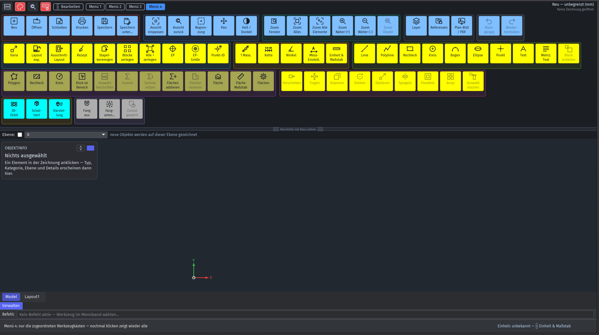

<p align="center">
  <a href="../../README.md">English</a> · <a href="README.bg.md">Български</a> · <a href="README.pt-BR.md">Português (Brasil)</a> · <a href="README.cs.md">Čeština</a> · <a href="README.nl.md">Nederlands</a> · <a href="README.fr.md">Français</a> · <a href="README.fi.md">Suomi</a> · <a href="README.de.md">Deutsch</a> · <a href="README.el.md">Ελληνικά</a> · <a href="README.hu.md">Magyar</a> · <a href="README.it.md">Italiano</a> · <a href="README.ja.md">日本語</a> · <a href="README.ko.md">한국어</a> · <a href="README.pl.md">Polski</a> · <a href="README.ru.md">Русский</a> · <a href="README.zh-CN.md">简体中文</a> · <a href="README.es.md">Español</a> · <a href="README.zh-TW.md">繁體中文</a> · <a href="README.tr.md">Türkçe</a> · <a href="README.hi.md">हिन्दी</a> · <a href="README.ar.md">العربية</a>
</p>

<p align="center"></p>
<h1 align="center">Open CAD Studio</h1>
<p align="center">Avoimen lähdekoodin 2D-piirtäminen ja 3D-mallinnus työpöydälle ja verkkoon, toteutettu Rustilla.</p>

<p align="center">
  <a href="https://github.com/HakanSeven12/OpenCADStudio/releases/latest"></a>
  <a href="https://github.com/HakanSeven12/OpenCADStudio/releases"></a>
  <a href="https://github.com/HakanSeven12/OpenCADStudio/stargazers"></a>
  <a href="../../LICENSE"></a>
</p>

<p align="center">
  <a href="https://www.opencadstudio.com"><strong>Käynnistä verkkosovellus</strong></a> ·
  <a href="https://github.com/HakanSeven12/OpenCADStudio/releases/latest"><strong>Lataa työpöytäsovellus</strong></a> ·
  <a href="https://github.com/HakanSeven12/OpenCADStudio/discussions"><strong>Osallistu keskusteluun</strong></a>
</p>

## Yleiskatsaus

Open CAD Studio on monialustainen sovellus tekniseen piirtämiseen, asettelutyöhön ja solidimallinnukseen. Se lukee ja kirjoittaa DWG- ja DXF-piirustuksia suoraan, ja työpöytä- sekä selainversiot käyttävät samaa muokkausydintä.

Projektia kehitetään aktiivisesti. Säilytä tärkeistä tuotantopiirustuksista varmuuskopiot ja ilmoita toistettavista ongelmista [GitHub Issuesissa](https://github.com/HakanSeven12/OpenCADStudio/issues).

<p align="center"></p>

## Asennus

Lataa kaikki nykyiset paketit [uusimmasta julkaisusta](https://github.com/HakanSeven12/OpenCADStudio/releases/latest).

### Windows

Valitse allekirjoitettu x86-64-paketti:

- `OpenCADStudio-*-windows-x86_64-installer.msi` — suositeltu asennusohjelma, joka sisältää Käynnistä-valikon pikakuvakkeet, DWG/DXF-tiedostokytkennät ja piirustusten esikatselut.
- `OpenCADStudio-*-windows-x86_64-portable.exe` — itsenäinen sovellus, joka ei vaadi asennusta.

### Linux

Lataa x86-64 AppImage, tee siitä suoritettava ja käynnistä se:

```bash
chmod +x OpenCADStudio-*-linux-x86_64.AppImage
./OpenCADStudio-*-linux-x86_64.AppImage
```

### macOS

Julkaistu macOS-paketti tukee Apple Siliconia:

1. Lataa `OpenCADStudio-*-macos-arm64.dmg`.
2. Avaa levykuva ja vedä `OpenCADStudio.app` kansioon **Applications**.
3. Jos Gatekeeper estää ensimmäisen käynnistyksen, hyväksy sovellus kohdassa **System Settings → Privacy & Security**.

Sovellus on allekirjoitettu ad hoc -allekirjoituksella, mutta Apple ei ole tällä hetkellä notaroinut sitä.

## Kielet

Open CAD Studio voi seurata järjestelmän kieltä tai käyttää jotakin näistä 21 käyttöliittymäkielestä:

> Arabia · Brasilianportugali · Bulgaria · Tšekki · Hollanti · Englanti · Suomi · Ranska · Saksa · Kreikka · Hindi · Unkari · Italia · Japani · Korea · Puola · Venäjä · Yksinkertaistettu kiina · Espanja · Perinteinen kiina · Turkki

Vaihda kieli sovelluksen asetuksissa. Selainversio käyttää myös selaimen ensisijaista kielialuetta, kun **Järjestelmä** on valittu.

## Kääntäminen lähdekoodista

### Työpöytä

Vaatimukset:

- Git
- Nykyinen vakaa Rust-työkaluketju
- Alustan grafiikka- ja fonttikehityskirjastot

Asenna natiiviriippuvuudet Ubuntussa tai Debianissa:

```bash
sudo apt update
sudo apt install libgl1-mesa-dev libx11-dev libxcursor-dev libxi-dev \
  libxrandr-dev libxkbcommon-dev libwayland-dev libfontconfig1-dev \
  libfreetype6-dev
```

Käännä sitten:

```bash
git clone https://github.com/HakanSeven12/OpenCADStudio.git
cd OpenCADStudio
cargo build --release --bin OpenCADStudio
```

Tuloksena syntyvä ohjelmatiedosto kirjoitetaan polkuun `target/release/OpenCADStudio` (Windowsissa `OpenCADStudio.exe`).

### Web

Asenna WebAssembly-kohde ja rakennustyökalut kerran:

```bash
rustup target add wasm32-unknown-unknown
cargo install trunk wasm-bindgen-cli
```

Käynnistä kehityspalvelin:

```bash
trunk serve
```

## Automaatio

Työpöytäohjelma tukee kertaluonteista muunnosta ja pysyvää käyttöliittymätöntä palvelinta:

```bash
OpenCADStudio --export input.dwg output.dxf
OpenCADStudio --serve
OpenCADStudio --serve --port 4242
OpenCADStudio --mcp
```

Palvelin vaihtaa yhden JSON-objektin riviä kohti vakiotulon/-lähdön tai paikallisen TCP-pistokkeen kautta. Katso [automaatio-opas](../automation/README.md).

## Liitännäiset

Työpöytäliitännäiset suoritetaan erillisissä prosesseissa ja ne viestivät isännän kanssa versioidun liitännäisrajapinnan kautta. Selainversio ei lataa natiiviliitännäisiä.

- [Liitännäisarkkitehtuuri](../plugin-architecture.md)
- [Liitännäismalli](../plugin-template/README.md)
- [Liitännäisrekisteri](../../plugins/README.md)

## Projektin dokumentaatio

- [Automaatiorajapinta](../automation/README.md)
- [Liitännäisarkkitehtuuri](../plugin-architecture.md)
- [Tessellointiputki](../tessellation.md)
- [Tietoturvakäytäntö](../../SECURITY.md)

## Osallistuminen

Virheraportit, rajatut pull requestit, käännökset, dokumentaatioparannukset ja liitännäisosallistuminen ovat tervetulleita.

- Etsi olemassa olevista [issueista](https://github.com/HakanSeven12/OpenCADStudio/issues) ennen uuden raportin avaamista.
- Käytä [Discussions](https://github.com/HakanSeven12/OpenCADStudio/discussions)-osiota kysymyksiin ja ideoihin.
- Ilmoita haavoittuvuuksista yksityisesti [tietoturvakäytännön](../../SECURITY.md) mukaisesti.

## Lisenssi

Open CAD Studioa jaetaan [GNU General Public License v3.0](../../LICENSE) -lisenssillä.
