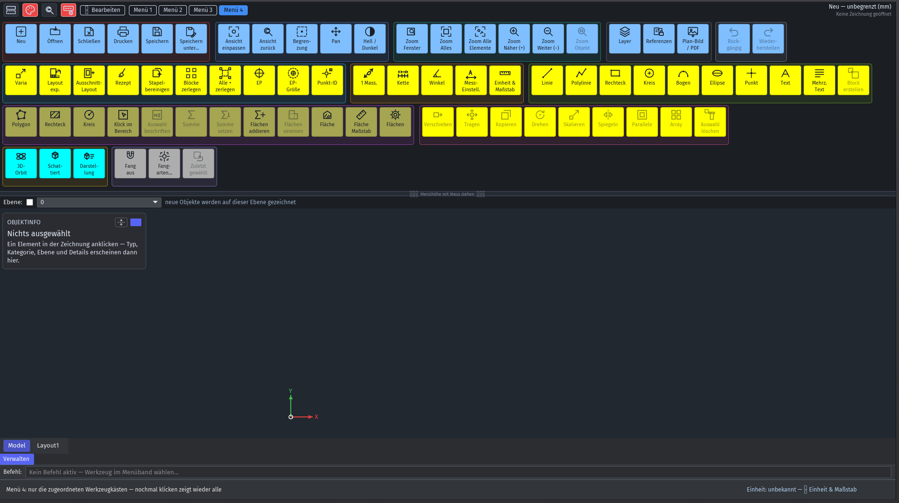

<p align="center">
  <a href="../../README.md">English</a> · <a href="README.bg.md">Български</a> · <a href="README.pt-BR.md">Português (Brasil)</a> · <a href="README.cs.md">Čeština</a> · <a href="README.nl.md">Nederlands</a> · <a href="README.fr.md">Français</a> · <a href="README.fi.md">Suomi</a> · <a href="README.de.md">Deutsch</a> · <a href="README.el.md">Ελληνικά</a> · <a href="README.hu.md">Magyar</a> · <a href="README.it.md">Italiano</a> · <a href="README.ja.md">日本語</a> · <a href="README.ko.md">한국어</a> · <a href="README.pl.md">Polski</a> · <a href="README.ru.md">Русский</a> · <a href="README.zh-CN.md">简体中文</a> · <a href="README.es.md">Español</a> · <a href="README.zh-TW.md">繁體中文</a> · <a href="README.tr.md">Türkçe</a> · <a href="README.hi.md">हिन्दी</a> · <a href="README.ar.md">العربية</a>
</p>

<p align="center"></p>
<h1 align="center">Open CAD Studio</h1>
<p align="center">Rust로 개발한 데스크톱 및 웹용 오픈 소스 2D 제도·3D 모델링 애플리케이션입니다.</p>

<p align="center">
  <a href="https://github.com/HakanSeven12/OpenCADStudio/releases/latest"></a>
  <a href="https://github.com/HakanSeven12/OpenCADStudio/releases"></a>
  <a href="https://github.com/HakanSeven12/OpenCADStudio/stargazers"></a>
  <a href="../../LICENSE"></a>
</p>

<p align="center">
  <a href="https://www.opencadstudio.com"><strong>웹 앱 실행</strong></a> ·
  <a href="https://github.com/HakanSeven12/OpenCADStudio/releases/latest"><strong>데스크톱 앱 다운로드</strong></a> ·
  <a href="https://github.com/HakanSeven12/OpenCADStudio/discussions"><strong>토론 참여</strong></a>
</p>

## 개요

Open CAD Studio는 기술 도면 작성, 배치 작업, 솔리드 모델링을 위한 크로스 플랫폼 애플리케이션입니다. DWG 및 DXF 도면을 기본 형식으로 읽고 쓰며 데스크톱 버전과 브라우저 버전이 같은 편집 코어를 공유합니다.

이 프로젝트는 활발히 개발되고 있습니다. 중요한 실무 도면은 백업을 보관하고 재현 가능한 문제는 [GitHub Issues](https://github.com/HakanSeven12/OpenCADStudio/issues)에 보고해 주세요.

<p align="center"></p>

## 설치

현재 제공되는 모든 패키지는 [최신 릴리스](https://github.com/HakanSeven12/OpenCADStudio/releases/latest)에서 다운로드할 수 있습니다.

### Windows

서명된 x86-64 패키지 중 하나를 선택하세요.

- `OpenCADStudio-*-windows-x86_64-installer.msi` — 시작 메뉴 바로 가기, DWG/DXF 파일 연결, 도면 미리보기가 포함된 권장 설치 프로그램입니다.
- `OpenCADStudio-*-windows-x86_64-portable.exe` — 설치가 필요 없는 독립 실행형 애플리케이션입니다.

### Linux

x86-64 AppImage를 다운로드하고 실행 권한을 부여한 뒤 실행하세요.

```bash
chmod +x OpenCADStudio-*-linux-x86_64.AppImage
./OpenCADStudio-*-linux-x86_64.AppImage
```

### macOS

배포되는 macOS 패키지는 Apple Silicon을 지원합니다.

1. `OpenCADStudio-*-macos-arm64.dmg`를 다운로드합니다.
2. 이미지를 열고 `OpenCADStudio.app`을 **Applications**로 드래그합니다.
3. Gatekeeper가 첫 실행을 차단하면 **System Settings → Privacy & Security**에서 앱을 허용합니다.

애플리케이션은 임시 서명되어 있지만 현재 Apple 공증을 받지 않았습니다.

## 언어

Open CAD Studio는 시스템 언어를 따르거나 다음 21개 인터페이스 언어 중 하나를 사용할 수 있습니다.

> 아랍어 · 브라질 포르투갈어 · 불가리아어 · 체코어 · 네덜란드어 · 영어 · 핀란드어 · 프랑스어 · 독일어 · 그리스어 · 힌디어 · 헝가리어 · 이탈리아어 · 일본어 · 한국어 · 폴란드어 · 러시아어 · 중국어 간체 · 스페인어 · 중국어 번체 · 터키어

애플리케이션 설정에서 언어를 변경할 수 있습니다. **시스템**을 선택하면 브라우저 버전도 브라우저의 기본 로캘을 사용합니다.

## 소스에서 빌드

### 데스크톱

요구 사항:

- Git
- 최신 안정 Rust 툴체인
- 플랫폼별 그래픽 및 글꼴 개발 라이브러리

Ubuntu 또는 Debian에서는 네이티브 종속성을 설치하세요.

```bash
sudo apt update
sudo apt install libgl1-mesa-dev libx11-dev libxcursor-dev libxi-dev \
  libxrandr-dev libxkbcommon-dev libwayland-dev libfontconfig1-dev \
  libfreetype6-dev
```

그런 다음 빌드합니다.

```bash
git clone https://github.com/HakanSeven12/OpenCADStudio.git
cd OpenCADStudio
cargo build --release --bin OpenCADStudio
```

생성된 바이너리는 `target/release/OpenCADStudio`에 저장됩니다(Windows에서는 `OpenCADStudio.exe`).

### 웹

WebAssembly 대상과 빌드 도구를 한 번 설치하세요.

```bash
rustup target add wasm32-unknown-unknown
cargo install trunk wasm-bindgen-cli
```

개발 서버를 시작합니다.

```bash
trunk serve
```

## 자동화

데스크톱 바이너리는 일회성 변환과 지속형 헤드리스 서버를 지원합니다.

```bash
OpenCADStudio --export input.dwg output.dxf
OpenCADStudio --serve
OpenCADStudio --serve --port 4242
OpenCADStudio --mcp
```

서버는 표준 입출력 또는 로컬 TCP 소켓을 통해 한 줄에 하나의 JSON 객체를 교환합니다. [자동화 안내서](../automation/README.md)를 참고하세요.

## 플러그인

데스크톱 플러그인은 별도 프로세스에서 실행되며 버전이 지정된 플러그인 API를 통해 호스트와 통신합니다. 브라우저 빌드는 네이티브 플러그인을 불러오지 않습니다.

- [플러그인 아키텍처](../plugin-architecture.md)
- [플러그인 템플릿](../plugin-template/README.md)
- [플러그인 레지스트리](../../plugins/README.md)

## 프로젝트 문서

- [자동화 API](../automation/README.md)
- [플러그인 아키텍처](../plugin-architecture.md)
- [테셀레이션 파이프라인](../tessellation.md)
- [보안 정책](../../SECURITY.md)

## 기여하기

버그 보고, 목적이 분명한 pull request, 번역, 문서 개선, 플러그인 기여를 환영합니다.

- 새 보고서를 열기 전에 기존 [issues](https://github.com/HakanSeven12/OpenCADStudio/issues)를 검색하세요.
- 질문과 아이디어는 [Discussions](https://github.com/HakanSeven12/OpenCADStudio/discussions)를 이용하세요.
- 취약점은 [보안 정책](../../SECURITY.md)에 따라 비공개로 보고하세요.

## 라이선스

Open CAD Studio는 [GNU General Public License v3.0](../../LICENSE)에 따라 배포됩니다.
