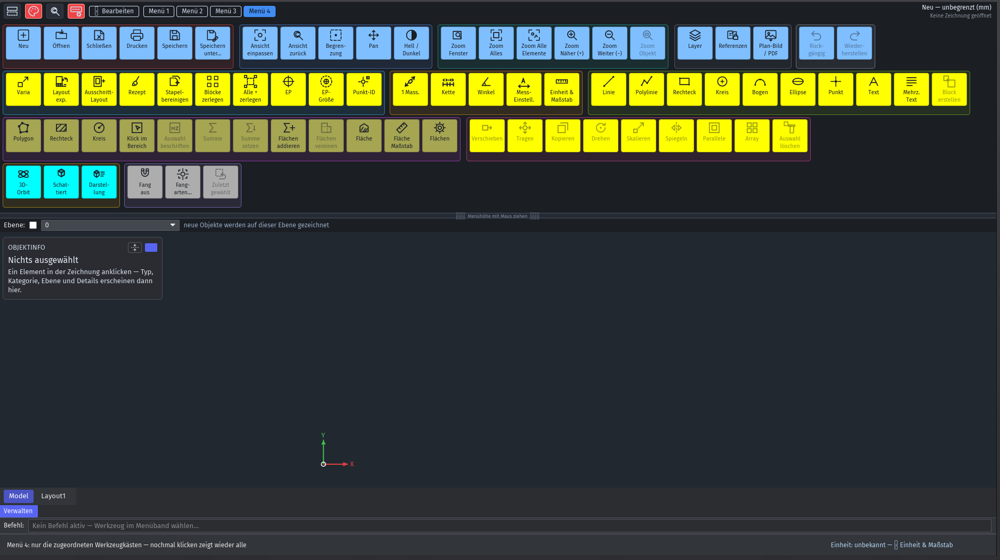

<p align="center">
  <a href="../../README.md">English</a> · <a href="README.bg.md">Български</a> · <a href="README.pt-BR.md">Português (Brasil)</a> · <a href="README.cs.md">Čeština</a> · <a href="README.nl.md">Nederlands</a> · <a href="README.fr.md">Français</a> · <a href="README.fi.md">Suomi</a> · <a href="README.de.md">Deutsch</a> · <a href="README.el.md">Ελληνικά</a> · <a href="README.hu.md">Magyar</a> · <a href="README.it.md">Italiano</a> · <a href="README.ja.md">日本語</a> · <a href="README.ko.md">한국어</a> · <a href="README.pl.md">Polski</a> · <a href="README.ru.md">Русский</a> · <a href="README.zh-CN.md">简体中文</a> · <a href="README.es.md">Español</a> · <a href="README.zh-TW.md">繁體中文</a> · <a href="README.tr.md">Türkçe</a> · <a href="README.hi.md">हिन्दी</a> · <a href="README.ar.md">العربية</a>
</p>

<p align="center"></p>
<h1 align="center">Open CAD Studio</h1>
<p align="center">使用 Rust 构建、面向桌面端和网页端的开源二维绘图与三维建模应用。</p>

<p align="center">
  <a href="https://github.com/HakanSeven12/OpenCADStudio/releases/latest"></a>
  <a href="https://github.com/HakanSeven12/OpenCADStudio/releases"></a>
  <a href="https://github.com/HakanSeven12/OpenCADStudio/stargazers"></a>
  <a href="../../LICENSE"></a>
</p>

<p align="center">
  <a href="https://www.opencadstudio.com"><strong>启动网页应用</strong></a> ·
  <a href="https://github.com/HakanSeven12/OpenCADStudio/releases/latest"><strong>下载桌面应用</strong></a> ·
  <a href="https://github.com/HakanSeven12/OpenCADStudio/discussions"><strong>参与讨论</strong></a>
</p>

## 概览

Open CAD Studio 是一款用于技术绘图、布局设计和实体建模的跨平台应用。它可原生读取和写入 DWG 与 DXF 图纸，桌面版和浏览器版共享同一套编辑核心。

本项目正在积极开发中。请保留重要生产图纸的备份，并通过 [GitHub Issues](https://github.com/HakanSeven12/OpenCADStudio/issues) 报告可重现的问题。

<p align="center"></p>

## 安装

请从[最新版本](https://github.com/HakanSeven12/OpenCADStudio/releases/latest)下载所有当前软件包。

### Windows

请选择一个已签名的 x86-64 软件包：

- `OpenCADStudio-*-windows-x86_64-installer.msi` — 推荐的安装程序，包含开始菜单快捷方式、DWG/DXF 文件关联和图纸缩略图。
- `OpenCADStudio-*-windows-x86_64-portable.exe` — 无需安装的独立应用程序。

### Linux

下载 x86-64 AppImage，添加执行权限并运行：

```bash
chmod +x OpenCADStudio-*-linux-x86_64.AppImage
./OpenCADStudio-*-linux-x86_64.AppImage
```

### macOS

发布的 macOS 软件包支持 Apple Silicon：

1. 下载 `OpenCADStudio-*-macos-arm64.dmg`。
2. 打开镜像，将 `OpenCADStudio.app` 拖入 **Applications**。
3. 如果 Gatekeeper 阻止首次启动，请在 **System Settings → Privacy & Security** 中允许该应用。

应用采用临时签名，但目前尚未通过 Apple 公证。

## 语言

Open CAD Studio 可以跟随系统语言，也可以使用以下 21 种界面语言：

> 阿拉伯语 · 巴西葡萄牙语 · 保加利亚语 · 捷克语 · 荷兰语 · 英语 · 芬兰语 · 法语 · 德语 · 希腊语 · 印地语 · 匈牙利语 · 意大利语 · 日语 · 韩语 · 波兰语 · 俄语 · 简体中文 · 西班牙语 · 繁体中文 · 土耳其语

可在应用设置中更改语言。选择**系统**时，浏览器版也会使用浏览器的首选区域设置。

## 从源代码构建

### 桌面版

要求：

- Git
- 当前稳定版 Rust 工具链
- 对应平台的图形和字体开发库

在 Ubuntu 或 Debian 上安装原生依赖：

```bash
sudo apt update
sudo apt install libgl1-mesa-dev libx11-dev libxcursor-dev libxi-dev \
  libxrandr-dev libxkbcommon-dev libwayland-dev libfontconfig1-dev \
  libfreetype6-dev
```

然后构建：

```bash
git clone https://github.com/HakanSeven12/OpenCADStudio.git
cd OpenCADStudio
cargo build --release --bin OpenCADStudio
```

生成的二进制文件位于 `target/release/OpenCADStudio`（Windows 上为 `OpenCADStudio.exe`）。

### 网页版

一次性安装 WebAssembly 目标和构建工具：

```bash
rustup target add wasm32-unknown-unknown
cargo install trunk wasm-bindgen-cli
```

启动开发服务器：

```bash
trunk serve
```

## 自动化

桌面二进制程序支持一次性转换和持续运行的无界面服务器：

```bash
OpenCADStudio --export input.dwg output.dxf
OpenCADStudio --serve
OpenCADStudio --serve --port 4242
OpenCADStudio --mcp
```

服务器通过标准输入/输出或本地 TCP 套接字逐行交换 JSON 对象。请参阅[自动化指南](../automation/README.md)。

## 插件

桌面插件运行于独立进程中，并通过有版本管理的插件 API 与主程序通信。浏览器版本不会加载原生插件。

- [插件架构](../plugin-architecture.md)
- [插件模板](../plugin-template/README.md)
- [插件注册表](../../plugins/README.md)

## 项目文档

- [自动化 API](../automation/README.md)
- [插件架构](../plugin-architecture.md)
- [细分处理流程](../tessellation.md)
- [安全策略](../../SECURITY.md)

## 参与贡献

欢迎提交错误报告、目标明确的 pull request、翻译、文档改进和插件贡献。

- 提交新报告前请搜索现有 [issues](https://github.com/HakanSeven12/OpenCADStudio/issues)。
- 问题和想法请使用 [Discussions](https://github.com/HakanSeven12/OpenCADStudio/discussions)。
- 请按照[安全策略](../../SECURITY.md)私下报告漏洞。

## 许可证

Open CAD Studio 根据 [GNU General Public License v3.0](../../LICENSE) 分发。
